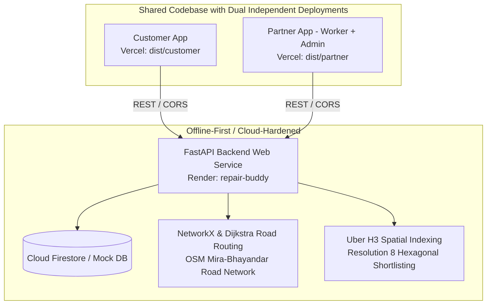
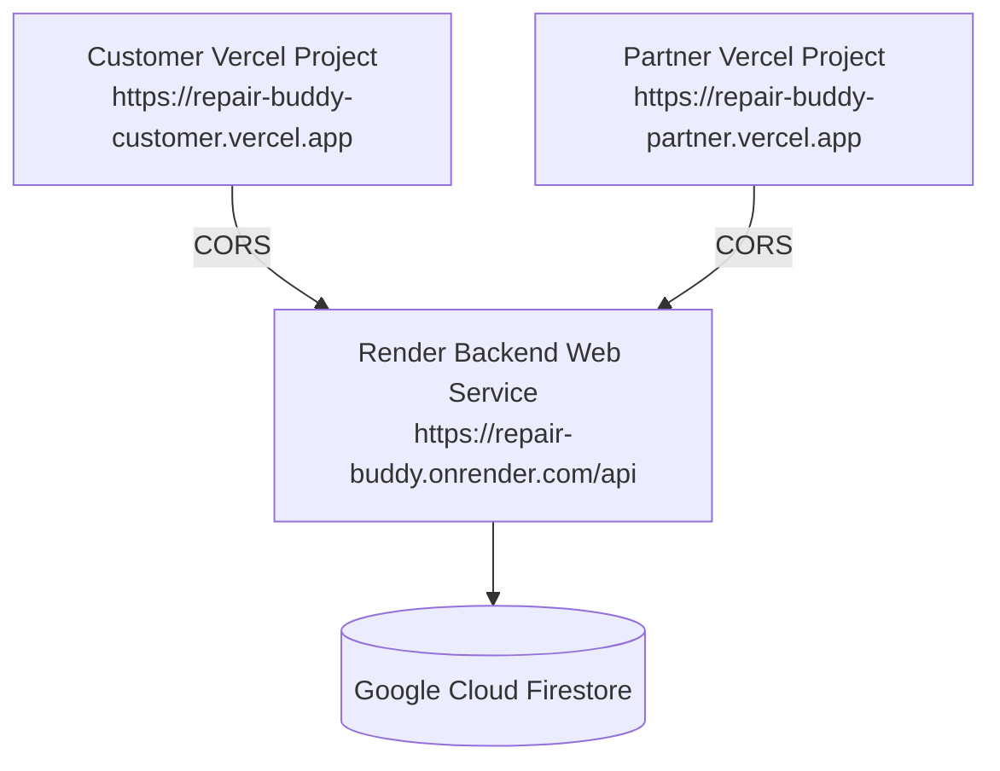

# RepairBuddy

> **"Blinkit for Blue-Collar Workers"** — Hyperlocal On-Demand Blue-Collar Services Platform  
> **Author & Developer:** Varun Jayshankar Gupta ([@varunjgupta25](https://github.com/varunjgupta25))  
> Built for VIT National Level Hackathon (Social Impact Domain)  
> Stack: **FastAPI (Backend) + React 19, Vite & Tailwind CSS (Frontend) + Firebase & Firestore**

---

## 1. Project Overview & Architecture

RepairBuddy is a "Blinkit for blue-collar workers" hyperlocal, on-demand service platform built for urban Indian households. It delivers sub-60-second worker matching and sub-30-minute arrival times for essential home services (electricians, plumbers, painters, cleaners, cooks, and carpenters).



### Key Differentiators
- **Independent Application Separation:** Single shared frontend codebase building two strictly isolated web applications: **Customer App** (booking, tracking, negotiation, reviews) and **Partner App** (worker dashboard, job feed, dispatch, earnings + admin verification and moderation).
- **Direct Cash Settlement (0% Platform Fee):** Transparent, zero-escrow financial model with direct cash payments upon customer confirmation.
- **Hyperlocal H3 + Road Network Routing:** Spatial indexing via Uber H3 filters nearby candidates; Dijkstra's algorithm over real OpenStreetMap road networks computes exact bike transit times (25 km/h) and route polylines.
- **Strict Verification & Dynamic Trust Scoring:** Worker verification pipeline (Aadhaar & Police Clearance verification via Partner App `/admin`). Unverified workers are excluded from match results. Trust Score (0–100) dynamically awards Bronze ($\ge 40$), Silver ($\ge 60$), and Gold ($\ge 80$) badges.
- **Emergency SOS Dispatch:** One-tap emergency alert broadcasting customer and worker GPS coordinates directly to administrative consoles.

---

## 2. Repository Layout

```
repair-buddy/
├── core/                        # FastAPI core (auth, config, persistent Firestore engine)
├── data/                        # Static road network (mira_bhayandar.graphml) & local store
├── models/                      # Pydantic models (job, offer, review, sos, user, worker)
├── routers/                     # FastAPI route handlers (jobs, offers, reviews, sos, workers, admin)
├── services/                    # Domain logic (H3 matching, Dijkstra routing, trust, negotiation)
├── tests/                       # 218 Pytest unit, integration, and security test cases
├── frontend/                    # React 19 + Vite + Tailwind CSS Monorepo
│   ├── src/
│   │   ├── apps/                # Independent app roots (CustomerApp.jsx, PartnerApp.jsx)
│   │   ├── api/                 # Unified API client & production-hardened mock isolation
│   │   ├── components/          # Shared reusable UI components
│   │   └── pages/               # Customer, Worker, and Admin views
│   ├── vercel.customer.json     # Vercel configuration for Customer App deployment
│   ├── vercel.partner.json      # Vercel configuration for Partner App deployment
│   ├── .env.customer            # Customer environment configuration
│   ├── .env.partner             # Partner environment configuration
│   ├── dist/
│   │   ├── customer/            # Production Customer App build output
│   │   └── partner/             # Production Partner App build output
│   └── package.json             # Build scripts and dependencies
├── docs/                        # Complete Phase 0 through Phase 4.2 architecture documentation
├── render.yaml                  # Render Infrastructure-as-Code Blueprint (Manual Deploy)
├── requirements.txt             # Python backend dependencies
└── seed.py                      # Protected Mira Road demo dataset seeder
```

---

## 3. Local Development Guide

### Step 1: Clone and Set Up Python Backend
```bash
# 1. Install backend dependencies
pip install -r requirements.txt

# 2. (Optional) Run safe database seeder in development
python seed.py --confirm-seed

# 3. Start backend server (port 8000)
uvicorn main:app --reload --port 8000
```
- API Base URL: `http://localhost:8000`
- Interactive Swagger Docs: `http://localhost:8000/docs`
- Health Endpoint: `http://localhost:8000/health`

### Step 2: Set Up and Run Frontend Apps
```bash
cd frontend
npm install

# Run Customer App locally (port 5173)
npm run dev:customer

# OR run Partner App locally (Worker + Admin)
npm run dev:partner
```

---

## 4. Database Seeding Safety Rules

To protect production and staging environments from accidental data corruption or demo overwrites, `seed.py` implements strict environment locks:

| Command | Environment | Behavior |
|---|---|---|
| `python seed.py` | Any | **Blocked**: Requires explicit `--confirm-seed` flag. |
| `python seed.py --confirm-seed` | `development` | Seeds demo users, workers, categories without wiping existing records. |
| `python seed.py --confirm-seed --clear --force-clear` | `development` | Wipes and re-seeds development collections. |
| `python seed.py ...` | `production` | **Permanently Prohibited**: Raises `RuntimeError` immediately. |
| `python seed.py ...` | `staging` | **Blocked** unless `ALLOW_STAGING_SEED=true`. |

---

## 5. Automated Test Suites

### Backend Tests (222 Tests Passing)
```bash
# Run complete backend pytest suite
pytest -v
```
Covers authentication, Firebase claim handling, CORS security, database isolation, Dijkstra routing, trust engine, lifecycle state machines, and seeding safeguards.

### Frontend Tests (66 Tests Passing) & Linting
```bash
cd frontend

# Run complete node test suite
npm test

# Run Oxlint linter (0 errors, 0 warnings)
npm run lint
```

---

## 6. Production Deployment Architecture

RepairBuddy deploys as two separate Vercel frontend projects communicating with one shared Render backend web service.



### 1. Customer Vercel Project
- **Project Name:** `repair-buddy-customer`
- **Root Directory:** `frontend`
- **Build Command:** `npm run build:customer`
- **Output Directory:** `dist/customer`
- **Environment Variables:**
  ```env
  VITE_APP=customer
  VITE_USE_MOCK=false
  VITE_API_BASE_URL=https://repair-buddy.onrender.com/api
  VITE_FIREBASE_API_KEY=your_firebase_api_key
  VITE_FIREBASE_PROJECT_ID=repair-buddy
  ```

### 2. Partner Vercel Project (Worker + Admin)
- **Project Name:** `repair-buddy-partner`
- **Root Directory:** `frontend`
- **Build Command:** `npm run build:partner`
- **Output Directory:** `dist/partner`
- **Environment Variables:**
  ```env
  VITE_APP=partner
  VITE_USE_MOCK=false
  VITE_API_BASE_URL=https://repair-buddy.onrender.com/api
  VITE_FIREBASE_API_KEY=your_firebase_api_key
  VITE_FIREBASE_PROJECT_ID=repair-buddy
  ```

### 3. Shared Render Backend
- **Service Name:** `repair-buddy`
- **Runtime:** Python 3.11+
- **Build Command:** `pip install -r requirements.txt`
- **Start Command:** `uvicorn main:app --host 0.0.0.0 --port $PORT`
- **Health Check Path:** `/health`
- **Auto Deploy:** `false` (Manual deploy for verified releases)
- **Required Environment Variables:**
  ```env
  ENV=production
  USE_MOCK_FIREBASE=false
  AUTO_SEED=false
  CUSTOMER_APP_ORIGIN=https://repair-buddy-customer.vercel.app
  PARTNER_APP_ORIGIN=https://repair-buddy-partner.vercel.app
  CORS_ORIGINS=https://repair-buddy-customer.vercel.app,https://repair-buddy-partner.vercel.app
  FIREBASE_CREDENTIALS_JSON={"type":"service_account",...}
  ```
