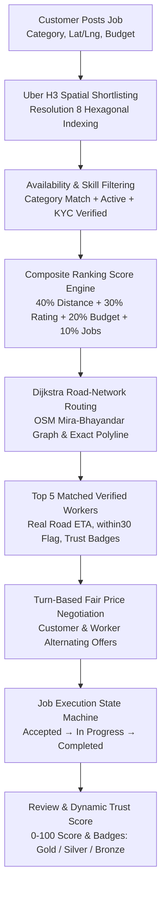

# RepairBuddy

> **"Blinkit for Blue-Collar Workers"** — Hyperlocal On-Demand Blue-Collar Services Platform  
> **Author & Developer:** Varun jayshankar gupta ([@varunjgupta25](https://github.com/varunjgupta25))  
> Built for VIT National Level Hackathon (Social Impact Domain)  
> Stack: **FastAPI (Backend) + React & Vite & Tailwind CSS (Frontend)**

---

## 1. Project Overview & Architecture

Repair Buddy is a "Blinkit for blue-collar workers" hyper-local, on-demand service platform built for urban Indian households. It delivers sub-60-second worker matching and sub-30-minute arrival times for essential home services (electricians, plumbers, painters, cleaners, cooks, and carpenters).



### Key Differentiators
- **Worker-Set Pricing & Turn-Based Negotiation:** Workers set their own standard rates; customers and workers negotiate directly through alternating offers and counters with zero corporate middleman commission.
- **Hyperlocal H3 + Road Network Routing:** Spatial indexing via Uber H3 filters nearby candidates; Dijkstra's algorithm over real OpenStreetMap road networks computes exact bike transit times ($25\text{ km/h}$) and route polylines.
- **Trust & Verification:** Strict worker verification pipeline (Aadhaar & Police Clearance verification via `/admin`). Unverified workers are excluded from match results. Trust Score (0–100) dynamically awards Bronze ($\ge 40$), Silver ($\ge 60$), and Gold ($\ge 80$) badges.
- **Emergency SOS Dispatch:** One-tap emergency alert broadcasting customer and worker GPS coordinates.

---

## 2. Repository Layout

```
repair-buddy/
├── core/                        # FastAPI core (auth, config, persistent Firestore engine)
├── data/                        # Static road network (mira_bhayandar.graphml) & local store
├── models/                      # Pydantic models (job, offer, review, sos, user, worker)
├── routers/                     # FastAPI route handlers (jobs, offers, reviews, sos, workers, admin)
├── services/                    # Domain logic (H3 matching, Dijkstra routing, trust, negotiation)
├── scripts/                     # Automated test suites, deployment verification, and demo tools
│   ├── e2e_deployed.py          # Complete 21-step deployed / local environment verification
│   ├── local_test_suite.py      # Core backend logic test suite
│   ├── local_integration_test.py# Local live API integration test
│   ├── verify_live_flow.py      # Live worker match & verification flow check
│   └── verify_verification_security.py # Worker registration & admin Aadhaar verification check
├── tests/                       # 95 Pytest test cases covering all edge cases
├── frontend/                    # React 19 + Vite + Tailwind CSS SPA
│   ├── src/                     # React source (pages, components, api client, contexts)
│   ├── vercel.json              # Vercel SPA catch-all rewrite rule
│   ├── .env.production.example  # Production environment variables example
│   └── package.json             # Frontend dependencies and build scripts
├── demo/                        # Demo assets and smoke test screenshots
├── DEMO.md                      # Complete 3-minute hackathon demo script & fallback guide
├── render.yaml                  # Render Infrastructure-as-Code Blueprint
├── Procfile                     # Web process definition for Render
├── requirements.txt             # Python backend dependencies
└── seed.py                      # Realistic Mira Road, Mumbai demo dataset seeder
```

---

## 3. How to Run Locally in 5 Commands

```bash
# 1. Install backend dependencies
pip install -r requirements.txt

# 2. Seed database with Mira Road demo dataset (25 workers, 5 customers, 5 jobs, 1 admin)
python seed.py

# 3. Start backend server (port 8000)
uvicorn main:app --reload --port 8000

# 4. Install frontend dependencies
cd frontend && npm install

# 5. Start frontend dev server (port 5173)
npm run dev
```

- API Base URL: `http://localhost:8000`
- Interactive Swagger Docs: `http://localhost:8000/docs`
- Frontend Web App: `http://localhost:5173`

---

## 4. Run Automated Test Suites

```bash
# Run all 95 backend unit and integration tests
pytest -v

# Run the full 21-step end-to-end verification against the local server
python scripts/e2e_deployed.py http://127.0.0.1:8000
```

---

## 5. Complete cURL Commands for Every Endpoint

> Note: All endpoints accept `Authorization: Bearer <token>`. In local development/demo mode, use user UIDs directly (e.g. `cust_priya`, `worker_elec_1`, `worker_plumber_1`).

### 1. Health Check
```bash
curl -X GET "http://localhost:8000/health"
```

---

### 2. Match Workers for a Job (`GET /workers/match?jobId=...`)
Returns verified, available workers matching the skill within their service radius, ranked by score (distance 40%, rating 30%, price vs budget 20%, jobsDone 10%), with `distanceKm`, `etaMinutes`, `within30`, and trust badges.
```bash
curl -X GET "http://localhost:8000/workers/match?jobId=job_seed_plumber_open" \
     -H "Authorization: Bearer cust_priya"
```

---

### 3. Create a Job (`POST /jobs`)
```bash
curl -X POST "http://localhost:8000/jobs" \
     -H "Authorization: Bearer cust_priya" \
     -H "Content-Type: application/json" \
     -d '{
       "category": "plumber",
       "description": "Bathroom tap leakage and low water pressure",
       "location": {
         "lat": 19.2825,
         "lng": 72.8570,
         "address": "Flat 402, Beverly Park, Mira Road East, Mumbai"
       },
       "budget": 350.0,
       "mode": "on-demand"
     }'
```

---

### 4. Get Job Details (`GET /jobs/{id}`)
Hides exact address from unassigned workers; reveals upon booking confirmation.
```bash
curl -X GET "http://localhost:8000/jobs/job_seed_plumber_open" \
     -H "Authorization: Bearer cust_priya"
```

---

### 5. Worker Nearby Job Feed (`GET /jobs/nearby`)
Returns open/negotiating jobs matching worker skills within their service radius, sorted by distance.
```bash
curl -X GET "http://localhost:8000/jobs/nearby" \
     -H "Authorization: Bearer worker_plumber_1"
```

---

### 6. Make an Offer (`POST /offers`)
Can be created by customer or worker. Sets job status to `negotiating`.
```bash
curl -X POST "http://localhost:8000/offers" \
     -H "Authorization: Bearer cust_priya" \
     -H "Content-Type: application/json" \
     -d '{
       "jobId": "job_seed_plumber_open",
       "workerId": "worker_plumber_1",
       "price": 300.0,
       "by": "customer"
     }'
```

---

### 7. Counter an Offer (`POST /offers/{id}/counter`)
Enforces alternating turns: only the other party can counter.
```bash
curl -X POST "http://localhost:8000/offers/offer_seed_demo_1/counter" \
     -H "Authorization: Bearer cust_amit" \
     -H "Content-Type: application/json" \
     -d '{
       "price": 480.0
     }'
```

---

### 8. Accept an Offer (`POST /offers/{id}/accept`)
Locks `acceptedWorkerId`, `finalPrice`, sets job `status = accepted`, and auto-rejects all other pending offers on this job.
```bash
curl -X POST "http://localhost:8000/offers/offer_seed_demo_1/accept" \
     -H "Authorization: Bearer cust_amit"
```

---

### 9. Reject an Offer (`POST /offers/{id}/reject`)
```bash
curl -X POST "http://localhost:8000/offers/offer_seed_demo_1/reject" \
     -H "Authorization: Bearer cust_amit"
```

---

### 10. Worker Starts Job (`POST /jobs/{id}/start`)
Validates that job status is `accepted` and requester is the assigned worker. Transitions status to `in_progress`.
```bash
curl -X POST "http://localhost:8000/jobs/job_seed_cleaner_accepted/start" \
     -H "Authorization: Bearer worker_cleaner_1"
```

---

### 11. Worker Completes Job (`POST /jobs/{id}/complete`)
Validates that job status is `in_progress`. Transitions status to `completed` and increments worker's `jobsDone` counter.
```bash
curl -X POST "http://localhost:8000/jobs/job_seed_painter_progress/complete" \
     -H "Authorization: Bearer worker_painter_1"
```

---

### 12. Submit Rating and Review (`POST /reviews`)
Requires job status to be `completed`. Automatically updates the worker's rolling average rating.
```bash
curl -X POST "http://localhost:8000/reviews" \
     -H "Authorization: Bearer cust_ananya" \
     -H "Content-Type: application/json" \
     -d '{
       "jobId": "job_seed_cook_completed",
       "workerId": "worker_cook_1",
       "rating": 5.0,
       "comment": "Delicious food cooked quickly. Very polite and clean!"
     }'
```

---

### 13. Emergency SOS Alert (`POST /sos`)
Records user coordinates and active job ID into `sos_alerts`.
```bash
curl -X POST "http://localhost:8000/sos" \
     -H "Authorization: Bearer cust_priya" \
     -H "Content-Type: application/json" \
     -d '{
       "jobId": "job_seed_plumber_open",
       "location": {
         "lat": 19.2825,
         "lng": 72.8570
       }
     }'
```

---

## 6. Mathematical Formulas Implemented

1. **Haversine Distance ($d$ in km):**
   $$a = \sin^2\left(\frac{\Delta \phi}{2}\right) + \cos(\phi_1)\cos(\phi_2)\sin^2\left(\frac{\Delta \lambda}{2}\right)$$
   $$d = 2 \cdot R \cdot \arctan2(\sqrt{a}, \sqrt{1-a}), \quad R = 6371\text{ km}$$

2. **ETA (Minutes):**
   $$\text{ETA} = \left(\frac{d}{25\text{ km/h}}\right) \times 60, \quad \text{within30} = (\text{ETA} \le 30.0)$$

3. **Matching Ranking Score (0–100):**
   $$\text{Score} = 0.40 \cdot S_{\text{dist}} + 0.30 \cdot S_{\text{rating}} + 0.20 \cdot S_{\text{price}} + 0.10 \cdot S_{\text{jobs}}$$

4. **Trust Score (0–100) & Badging:**
   $$\text{Trust} = \text{Verified}(30) + \text{RatingScaled}(30) + \text{JobsCapped}(20) + \text{Age}(10) + \text{CleanRecord}(10) - \text{Penalty}$$
   - **Gold:** $\ge 80$
   - **Silver:** $\ge 60$
   - **Bronze:** $\ge 40$

---

## 7. Deploy to Render

Repair Buddy includes automated deployment configuration for [Render](https://render.com) (`render.yaml` Blueprint and `Procfile`).

### Exact Deployment Steps

1. **Push your code to GitHub**:
   Ensure `data/mira_bhayandar.graphml`, `.python-version`, and `render.yaml` are committed.

2. **Create New Blueprint / Web Service on Render**:
   - Navigate to [Render Dashboard](https://dashboard.render.com).
   - Click **New +** → **Blueprint** (or **Web Service**).
   - Select your repository: `varunjgupta25/Team-CODE.IT_VarunGupta`.
   - Render will automatically detect `render.yaml`. If setting up manually as a Web Service:
     - **Runtime:** `Python` (pinned via `.python-version` to `3.11.9`)
     - **Build Command:** `pip install -r requirements.txt`
     - **Start Command:** `uvicorn main:app --host 0.0.0.0 --port $PORT`
     - **Health Check Path:** `/health`

3. **Configure Environment Variables**:
   In Render's **Environment** tab, configure the following variables:

   | Variable | Value / Example | Description |
   |---|---|---|
   | `ENV` | `production` | Environment mode |
   | `USE_MOCK_FIREBASE` | `true` | Runs in persistent mock Firestore mode (or provide `FIREBASE_CREDENTIALS_PATH` for live Firebase) |
   | `AUTO_SEED` | `true` | Idempotently seeds 25 workers, 5 customers, 5 jobs, and `admin_user` on cold boot if database is empty |
   | `CORS_ORIGINS` | `http://localhost:5173,https://repair-buddy.vercel.app` | Comma-separated list of exact allowed origins |
   | `CORS_ORIGIN_REGEX` | `https://.*\.vercel\.app` | Optional regex to permit all Vercel PR preview deployments |
   | `TRANSIT_SPEED_KMH` | `25.0` | Travel speed constant for ETA calculations |
   | `PORT` | *(Provided by Render automatically)* | Port assigned dynamically by Render |

4. **Verify Deployment**:
   - The deployment runs in ~30–45s installing wheel dependencies.
   - Render verifies the `/health` health check.
   - On startup, `auto_seed_if_empty()` populates the database and `load_graph()` preloads the Mira-Bhayandar road network (~2.41 MB, <160 MB peak RAM).

---

## 8. Deploy Frontend to Vercel

The frontend is an optimized React 19 + Vite single page application with `frontend/vercel.json` configured for seamless client-side routing fallback.

### Exact Click-by-Click Steps

1. **Navigate to Vercel Dashboard**:
   - Go to [vercel.com/new](https://vercel.com/new) and log in with your GitHub account.

2. **Import Repository**:
   - Select `varunjgupta25/Team-CODE.IT_VarunGupta`.

3. **Configure Project Settings**:
   - **Project Name:** `repair-buddy` (or any custom name)
   - **Framework Preset:** `Vite`
   - **Root Directory:** Click **Edit** and choose `frontend` *(Critical: Vercel must build inside `frontend/`)*
   - **Build Command:** `npm run build` *(Default)*
   - **Output Directory:** `dist` *(Default, matching `vercel.json`)*

4. **Set Environment Variables**:
   Expand the **Environment Variables** panel and add:

   | Variable | Value | Description |
   |---|---|---|
   | `VITE_USE_MOCK` | `false` | Disables client mock data and switches API client to LIVE mode |
   | `VITE_API_BASE_URL` | `https://<your-render-service>.onrender.com/api` | Full URL to your Render backend API (must end with `/api`) |

5. **Deploy**:
   - Click **Deploy**. Vercel will install dependencies and produce the production bundle in under 30 seconds.
   - Note your deployed URL (e.g. `https://repair-buddy-delta.vercel.app`).

6. **Link Vercel to Render Backend**:
   - Return to your [Render Dashboard](https://dashboard.render.com).
   - In your backend service's **Environment** tab, update `CORS_ORIGINS` to include your live Vercel URL:
     ```
     CORS_ORIGINS=http://localhost:5173,https://<your-vercel-domain>.vercel.app
     ```
   - Click **Save Changes** (Render will automatically re-deploy in ~15s).

---

## 9. Automated Post-Deployment Verification

Once both Render and Vercel services are running, execute the end-to-end verification script from your local terminal:

```bash
python scripts/e2e_deployed.py https://<your-render-service>.onrender.com --frontend-url https://<your-vercel-domain>.vercel.app
```

This automated suite runs 21 comprehensive validation checks against the live environment:
- **Cold-Start Resilience:** Automatically polls `/health` with exponential backoff for up to 90 seconds while Render spins up.
- **CORS Preflight:** Validates that preflight requests from the Vercel origin are allowed while unauthorized origins are blocked.
- **Seeded Data:** Validates seed workers and the admin user (`admin_user`).
- **Complete Booking Journey:** Posts a job, queries Dijkstra matching (verifying road ETA and polyline coordinates), negotiates counter-offers, starts job, completes job, and submits a review with rating recalculation.
- **Worker Verification Lifecycle:** Registers a new worker, submits Aadhaar KYC, retrieves pending queue via `/admin` with masked Aadhaar, approves the worker, and verifies immediate qualification for job matches.
- **Optional Browser Smoke Test:** If Playwright is installed, launches a headless browser to verify the frontend UI and captures verification screenshots into `demo/screenshots/`.

