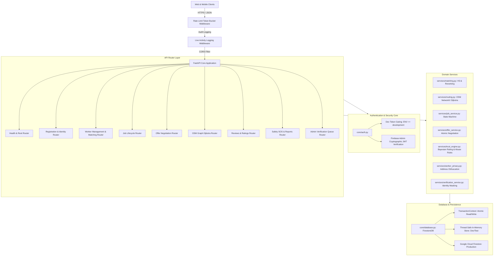

# BACKEND AUDIT: RepairBuddy Hyperlocal Services Engine

**Audit Date:** 2026-11-05  
**Auditor:** Principal Backend & Systems Reliability Architect  
**Project:** RepairBuddy Hyperlocal Household Marketplace  
**Repository:** `https://github.com/varunjgupta25/Team-CODE.IT_VarunGupta.git`  
**Deployment Target:** Render (`https://repair-buddy.onrender.com`)  
**Technology Stack:** Python 3.11 / 3.13, FastAPI 0.115+, Pydantic v2, Firebase Firestore, Uber H3 Spatial Index, NetworkX OSM Dijkstra Routing, Pytest.

---

## 1. Executive Architecture Summary

RepairBuddy is an on-demand hyperlocal marketplace designed to match urban households with verified service professionals (plumbers, electricians, cleaners, etc.) in high density within tight delivery windows (under 30 minutes).

The application operates as a single-process ASGI service running on FastAPI and Uvicorn. Its backend architecture combines spatial indexing, graph-based transit calculation, token-bucket rate limiting, atomic document transactions, and a Bayesian trust scoring engine.



---

## 2. Repository Structure Analysis

```text
Backend/
├── core/                       # Core infrastructure, authentication, database adapters
│   ├── auth.py                 # Firebase JWT verification, dev token gating, RBAC dependency
│   ├── config.py               # Pydantic BaseSettings, env normalization, CORS resolution
│   ├── database.py             # FirestoreDB adapter, TransactionContext, in-memory mock
│   └── rate_limit.py           # Thread-safe in-memory token bucket rate limiting middleware
├── data/                       # Static geospatial assets & local persistence
│   ├── mira_road_drive.graphml # Precomputed OpenStreetMap drive graph for Mira Road
│   └── store.json              # Optional local mock state store
├── models/                     # Strict Pydantic v2 domain schemas
│   ├── job.py                  # Job creation, state responses, category whitelisting
│   ├── offer.py                # Initial/counter offer contracts, price limits
│   ├── report.py               # Abuse reporting models, category tags
│   ├── review.py               # Customer review validation, rating bounds (1-5)
│   ├── sos.py                  # Emergency SOS alert contracts
│   ├── user.py                 # Customer and User registration schemas
│   └── worker.py               # Worker profiles, masked verifications, location schemas
├── routers/                    # Endpoint controllers mounted at root and /api
│   ├── admin.py                # Verification queue and document approval
│   ├── jobs.py                 # Customer registration, job lifecycle (create, start, complete, cancel)
│   ├── offers.py               # Turn-taking price negotiation state machine
│   ├── reports.py              # Abuse report intake and auto-flagging trigger
│   ├── reviews.py              # Rating submission and trust recalculation
│   ├── route.py                # Live Dijkstra shortest-path calculations
│   ├── sos.py                  # High-priority emergency trigger
│   └── workers.py              # Worker registration, feed, privacy masking, match query
├── services/                   # Decoupled business logic engines
│   ├── distance.py             # Haversine geographic distance utility
│   ├── h3_index.py             # Uber H3 resolution 8/9 spatial bucketing
│   ├── job_service.py          # State transitions, ownership and role validations
│   ├── matching.py             # Hyperlocal candidate discovery and multi-factor ranking
│   ├── offer_service.py        # Alternating offer logic with transaction-safe acceptance
│   ├── report_service.py       # Abuse ingestion and threshold evaluation
│   ├── routing.py              # OSM graph traversal, nearest-node projection, Dijkstra
│   ├── sos_service.py          # SOS alert handling
│   ├── trust.py                # Backward-compatibility re-export module
│   ├── trust_engine.py         # Bayesian rating, dynamic UTC account age, abuse engine
│   ├── verification_service.py # Aadhaar masking (XXXX-XXXX-1234) and admin review
│   └── worker_privacy.py       # Public profile stripping, street address obfuscation
├── tests/                      # 19 comprehensive test suites (186 passing tests)
├── Dockerfile                  # Container definition (Python 3.11-slim)
├── main.py                     # ASGI application root, lifespan, middlewares, routers
├── Procfile                    # Web process command for Render/Heroku
├── pytest.ini                  # Pytest testpath and warning configuration
├── render.yaml                 # Infrastructure-as-code for Render deployment
├── requirements.txt            # Production dependencies
├── runtime.txt                 # Target Python runtime (python-3.11.9)
└── seed.py                     # Initial database seeding script (CLI and automatic)
```

---

## 3. Module Responsibilities & Dependency Graph

### A. Core Layer (`core/`)
* **`core/config.py`**: Central source of truth for runtime configuration. Normalizes `ENV` and `ENVIRONMENT`. Parses `CORS_ORIGINS` and `ALLOWED_ORIGINS`, strictly removing wildcard `*` while injecting regex support for staging Vercel domains. Resolves Firebase credentials from raw JSON or path.
* **`core/auth.py`**: Enforces zero 401-fallthrough. Development tokens are strictly disabled when `ENV != "development"`. In production, verifies signatures via `firebase_admin.auth.verify_id_token`. Defines `require_role(...)` RBAC dependency.
* **`core/database.py`**: Encapsulates Firestore client management and an in-memory replica. Provides `run_transaction(callback)` with `TransactionContext`, guaranteeing atomic multi-resource updates across real Firestore and mock environments. Implements bulk fetch methods (`get_documents_in_bulk`, `get_reports_count_in_bulk`) to eliminate N+1 queries.
* **`core/rate_limit.py`**: Pure-Python token-bucket middleware. Tracks client IP buckets thread-safely:
  * SOS alert path: 5 req/min.
  * Auth write endpoints (`/register`, `/verify`): 10 req/min.
  * Default endpoints: 120 req/min.

### B. Service Layer (`services/`)
* **`services/matching.py`**: Matches workers for a job. Filters out workers who are unverified, unavailable, flagged, or `UNDER_REVIEW`. Computes composite scores combining Haversine distance (40%), Bayesian rating (30%), price vs budget (20%), and completed jobs (10%).
* **`services/routing.py`**: Loads `data/mira_road_drive.graphml` via NetworkX. Finds nearest graph nodes for job and worker coordinates and calculates shortest route, distance in kilometers, and estimated transit duration at calibrated transit speeds (default: 25 km/h).
* **`services/trust_engine.py`**: Calculates Bayesian weighted rating:
  $$\text{Weighted Rating} = \frac{(v \cdot R) + (m \cdot C)}{v + m}$$
  where $v$ is review count, $R$ is average worker rating, $m = 5.0$, and $C = 4.5$. Computes dynamic account age multiplier in UTC ($0.70 \to 1.0$). Automatically evaluates abuse thresholds ($\ge 3$ reports in 48 hours) to transition worker accounts to `UNDER_REVIEW`.
* **`services/worker_privacy.py`**: Serializes worker profiles based on requestor identity. Hides phone numbers, national IDs, and exact addresses from the public. Obfuscates coordinates to 2 decimal places in public feed representations.

---

## 4. Architectural Strengths Observed

1. **Decoupled Persistence Layer**: The application uses a unified `FirestoreDB` interface that supports real Firestore in production while allowing fast, zero-dependency in-memory execution for testing and local offline development.
2. **Atomic Transaction Wrappers**: State transitions that alter multiple records (such as accepting an offer, which simultaneously updates offer status, assigns the job's `acceptedWorkerId`, and rejects competing offers) are encapsulated in `db.run_transaction()`.
3. **Multi-Tier Security Architecture**: Every route is protected at the perimeter by IP-level token-bucket rate limiting, followed by cryptographic token verification, followed by granular RBAC role checks, followed by domain-level ownership validation.
4. **Spatial Optimization**: The matching engine integrates spatial proximity, Uber H3 indexing, and actual road-network topology via Dijkstra graph routing, ensuring realistic ETAs.
5. **No Third-Party Rate Limit Dependencies**: The rate limiter is implemented directly in standard library Python without requiring an external Redis instance, reducing infrastructure cost and failure surface.

---

## 5. Architectural Areas Requiring Attention (Phase 1 Recommendations)

1. **Persistent Cache for Graph Loading**: The OSM graph is read from disk on startup in `main.py` lifespan. While functional, caching the deserialized NetworkX structure in memory prevents cold-start delays.
2. **Render Production Data Persistence**: In `render.yaml`, `USE_MOCK_FIREBASE` is set to `"true"`, which means Render free-tier restarts wipe state. To achieve true production durability, a service account secret must be mounted and `USE_MOCK_FIREBASE` set to `"false"`.
3. **Distributed Rate Limiting**: The current token bucket operates in-memory per worker process. If deployed across multiple Uvicorn worker processes or container replicas, rate limit buckets will be isolated to each worker process rather than cluster-wide.

