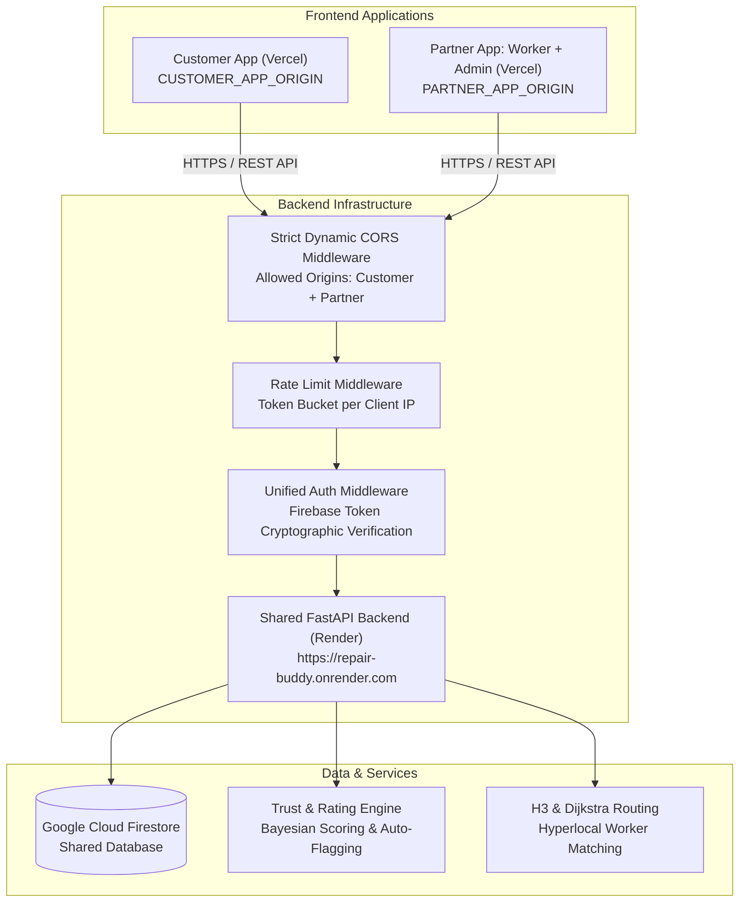

# Phase 4 — Backend Shared Architecture Report

## 1. Executive Summary

In Phase 4, the RepairBuddy backend is configured and verified to operate as a **single shared FastAPI service** supporting two independent frontend deployments:
1. **Customer App** (hosted on Vercel)
2. **Partner App** (Worker + Admin Console, hosted on Vercel)

Both client applications interface with the **same backend service** and the **same Google Cloud Firestore database**, preserving transactional consistency, role-based security, unified audit logging, and single-source-of-truth state transitions.

---

## 2. Shared Target Architecture

---

## 3. Core Architectural Principles Preserved

1. **Zero Backend Duplication**:
   - No separate backend services or serverless proxies were created.
   - All customer, worker, and admin routes remain in their respective canonical routers (`/jobs`, `/workers`, `/offers`, `/reviews`, `/admin`, `/reports`, `/sos`).
2. **Single Shared Database**:
   - Customer and Partner applications share collections (`users`, `workers`, `jobs`, `offers`, `reviews`, `reports`, `sos_alerts`).
   - No data duplication, schema branching, or synchronization pipelines required.
3. **Identity & Role Enforcement**:
   - Both frontends authenticate against the exact same Firebase Authentication project.
   - User identity (`uid`) is derived exclusively from the verified Bearer JWT; roles (`customer`, `worker`, `admin`) are strictly enforced server-side.
   - Request origin (HTTP `Origin` header) controls browser CORS access only and **never confers authorization or role privilege**.

---

## 4. Key Endpoints Shared Across Applications

| Endpoint Category | Method & Route | Customer App | Partner App (Worker) | Partner App (Admin) |
|---|---|---|---|---|
| Health & Diagnostics | `GET /health`, `GET /api/health` | Yes | Yes | Yes |
| Profile & Identity | `GET /users/me`, `POST /customers/register`, `POST /workers/register` | Customer | Worker | Admin |
| Worker Discovery | `GET /workers/match?jobId=...` | Read | Denied (403) | Read |
| Job Feed & Management | `POST /jobs`, `GET /jobs/{id}`, `GET /jobs/nearby` | Create/Read | Feed/Read/Start/Complete | Full Read/Cancel |
| Price Offers & Bids | `POST /offers`, `POST /offers/{id}/accept`, `POST /offers/{id}/counter` | Accept/Counter | Propose/Counter | Read |
| Reviews & Ratings | `POST /reviews`, `GET /reviews?workerId=...` | Create/Read | Read | Read |
| Identity Verification | `POST /workers/verify`, `GET /admin/verifications` | Denied (403) | Request | Approve/Reject |
| Safety & Moderation | `POST /reports`, `POST /sos`, `GET /admin/reports` | Report/SOS | SOS | Resolve/Dismiss |
| Admin Operations | `GET /admin/stats`, `POST /admin/users/{uid}/suspend` | Denied (403) | Denied (403) | Manage |

---

## 5. Architectural Verification & Stability

- **Test Suite Status**: 205 passed across 24 test modules.
- **Service Footprint**: 1 shared FastAPI instance, 0 conflicting dependencies, backward-compatible API contracts.

