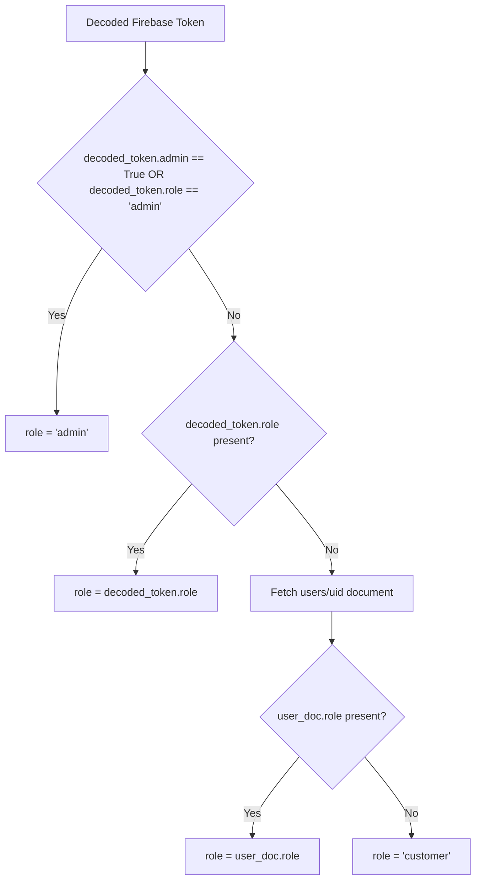

# Phase 4.1 — Authentication & Claim Consistency Report

**Project:** RepairBuddy  
**Branch:** `phase-4.1-stabilization`  
**Date:** 2026-11-06  

---

## 1. Context & Architectural Problem

RepairBuddy utilizes Firebase Authentication with three primary actor roles:
1. `customer`: Household users creating jobs, viewing bids, booking services.
2. `worker`: Partners viewing nearby jobs, bidding, and performing repairs.
3. `admin`: Platform administrators reviewing worker verification docs, monitoring SOS alerts, and moderating disputes.

### The Claim Mismatch Issue
When setting custom user claims with the official Firebase Admin SDK (e.g., via Cloud Functions, CLI, or admin scripts):
```python
firebase_admin.auth.set_custom_user_claims(uid, {"admin": True})
```
The resulting decoded ID token contains:
```json
{
  "uid": "adm_12345",
  "admin": true
}
```
However, the backend authorization dependency in `core/auth.py` previously queried:
```python
role = decoded_token.get("role")
```
Because the standard claim dictionary contains `"admin": True` and NOT `"role": "admin"`, `decoded_token.get("role")` returned `None`. The backend subsequently fell back to querying the user document in the database, and if the user document was cached or did not contain an explicit `role` field, it defaulted the user to `"customer"`. This resulted in `403 Forbidden` errors for legitimate administrators when calling admin endpoints (e.g., `/api/admin/verifications`).

Meanwhile, the frontend was already checking both conventions:
```javascript
const isAdmin = result.claims?.admin === true || result.claims?.role === 'admin';
```

---

## 2. Server-Side Claim Harmonization

In `core/auth.py`, role resolution was refactored to support both standard Firebase Admin boolean flags and explicit string roles:

```python
# Phase 4.1: Support standard Firebase custom claims where admin is a boolean ({'admin': True})
# as well as explicit role claims ({'role': 'admin'}).
if decoded_token.get("admin") is True or decoded_token.get("role") == "admin":
    role = "admin"
else:
    role = decoded_token.get("role")

# If role is still undetermined, query Firestore user document
if not role:
    db = get_db()
    user_doc = db.get("users", uid)
    if user_doc:
        role = user_doc.get("role")

# Default fallback
if not role:
    role = "customer"
```

### Flow Diagram



---

## 3. Role-Based Access Control (RBAC) Verification

The following matrix documents server-side enforcement across protected endpoints:

| Endpoint | Permitted Roles | Token Claim Tested | Backend Behavior | Result |
|---|---|---|---|---|
| `GET /api/admin/workers/verifications` | `admin` | `{"admin": True}` | Role resolved as `admin`, permission granted | Verified |
| `POST /api/admin/workers/{id}/verify` | `admin` | `{"role": "admin"}` | Role resolved as `admin`, permission granted | Verified |
| `GET /api/admin/workers/verifications` | `admin` | `{"role": "worker"}` | Role resolved as `worker`, returns `403 Forbidden` | Verified |
| `POST /api/jobs` | `customer` | `{"role": "customer"}` | Role resolved as `customer`, job created | Verified |
| `POST /api/jobs/{id}/bids` | `worker` | `{"role": "worker"}` | Role resolved as `worker`, bid placed | Verified |

---

## 4. Test Verification

Automated test in `tests/test_phase4_1_stabilization.py`:
- `test_firebase_admin_custom_claim_resolution`:
  Simulates decoded tokens with `{"admin": True}` and verifies that `get_current_user` resolves the user's role to `"admin"` without requiring secondary database queries.

All tests passed.
