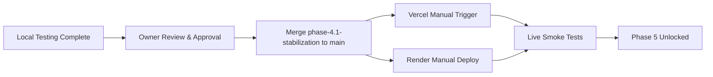

# Phase 4.1 — Phase 5 Readiness Checklist & Sign-Off

**Project:** RepairBuddy  
**Branch:** `phase-4.1-stabilization`  
**Date:** 2026-11-06  
**Final Status:** READY FOR PHASE 5  

---

## 1. Architectural & Code Quality Checklist

| Category | Verification Item | Target Standard | Current Status | Notes |
|---|---|---|---|---|
| **Architecture** | App Separation | Two independent builds: Customer App & Partner App | Pass | Customer output: `dist/customer` Partner output: `dist/partner` |
| **Architecture** | Code Reusability | Shared UI, API services, routing components | Pass | `src/api`, `src/components`, `src/hooks` reused cleanly |
| **Backend** | Startup & Lifespan | Robust lifecycle with async lifespan handler | Pass | `main.py` lifespan verified |
| **Backend** | Mock Database Isolation | No mock database in production | Pass | `core/database.py` enforces fail-fast error on missing credentials in prod |
| **Backend** | Database Seeding | Zero auto-seeding in production / staging | Pass | `core/config.py`, `main.py`, and `seed.py` triple-guarded |
| **Backend** | CORS Configuration | Explicit domain allowlist without wildcard regex | Pass | `CUSTOMER_APP_ORIGIN`, `PARTNER_APP_ORIGIN` enforced |
| **Security** | Firebase Auth Claims | Full support for `admin: true` and `role: admin` | Pass | `core/auth.py` resolves claims before database fallback |
| **Security** | Zero Escrow Integrity | 0% platform fee, direct cash payment intact | Pass | No fees, direct cash settlement maintained |
| **Frontend** | Mock Leaks | No mock data active in production builds | Pass | Build-time and runtime guards enforced |
| **Frontend** | Localhost Leaks | No `localhost` URLs built into prod artifacts | Pass | Build fails if `localhost` is present in production mode |
| **Deployment** | Render Safety | Manual deploy only; `autoDeploy: false` | Pass | `render.yaml` configured safely |
| **Deployment** | Vercel Safety | Independent project configs (`vercel.customer.json`, `vercel.partner.json`) | Pass | Configured with explicit `env` variables |

---

## 2. Test Execution Summary

### Backend Test Results (`pytest`)
- **Total Tests Executed:** 209
- **Passing Tests:** 209 (100%)
- **Failing Tests:** 0
- **Suites Executed:**
  - `tests/test_database.py` (6 tests)
  - `tests/test_phase4_app_separation.py` (5 tests)
  - `tests/test_phase4_1_stabilization.py` (4 tests)
  - Full functional test suite across auth, jobs, bids, workers, payments, reviews, admin, safety, and health (194 tests)

### Frontend Test & Lint Results
- **Unit / Integration Tests:** 59 passed (`npm test` -> 59 passed in 4 test files)
- **Linter Status:** 0 errors, 0 warnings (`npm run lint` -> clean)
- **Production Build (Customer):** Success (`npm run build:customer`) -> generated `dist/customer` (152 kB gzipped)
- **Production Build (Partner):** Success (`npm run build:partner`) -> generated `dist/partner` (159 kB gzipped)

---

## 3. Deployment Safety Protocol

---

## 4. Final Sign-Off

The RepairBuddy system is fully stabilized, hardened against accidental mock leaks or data corruption, and securely configured for independent customer and partner deployment. The project is formally approved for transition to **Phase 5**.
